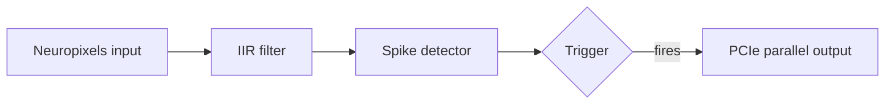

<!-- Internal reference, never published: how to write each widget a page may use. Its links and
pictures are written as from docs/pages/. See "Widgets" in docs/ongoing_work/website.md. -->

# Widget showcase

A sample book, not documentation: every widget the website's generator offers, each shown once with an example from Falcon's processors.

[:lucide-audio-waveform: IIR filter](processors/iir_filter.md){ .md-button .md-button--primary }
[:lucide-zap: Spike detector](processors/spike_detector.md){ .md-button }

## Cards

<div class="grid cards" markdown>

-   :lucide-audio-waveform:{ .lg .middle } __IIR filter__

    ---

    A recursive filter on every channel, as a cascade of second-order sections.

    [:lucide-arrow-right: Its page](processors/iir_filter.md)

-   :lucide-zap:{ .lg .middle } __Spike detector__

    ---

    An event on every sample where channels cross a fixed threshold.

    [:lucide-arrow-right: Its page](processors/spike_detector.md)

-   :lucide-book-a:{ .lg .middle } __Glossary__

    ---

    What the documentation means by channel, sample, event and its other terms.

    [:lucide-arrow-right: The terms](glossary.md)

-   :lucide-workflow:{ .lg .middle } __Overview__

    ---

    What Falcon is: a graph of processors between an acquisition system and an output.

    [:lucide-arrow-right: Start here](overview.md)

</div>

## Boxes

The twelve kinds, in a grid:

<div class="grid" markdown>

!!! note
    Every channel uses the same coefficients and keeps its own state.

!!! abstract
    The IIR filter runs every channel of its input through the same recursive filter.

!!! info
    The channel values arrive as 32-bit numbers, and the filter computes with 64-bit ones.

!!! tip
    Design the filter no sharper than the experiment needs: sharper edges add delay.

!!! success
    A box for something that went well, such as a check that passed.

!!! question
    Which threshold? A common choice is four to five times the noise's standard deviation.

!!! warning
    A value exactly equal to the threshold isn't beyond it.

!!! failure
    Falcon refuses a graph whose IIR filter has an unstable section.

!!! danger
    The output of an unstable filter grows without bound.

!!! bug
    A box for a known problem.

!!! example
    A band-pass from 300 Hz to 6000 Hz, for an input at 30 kHz, has two sections.

!!! quote
    Falcon: a highly flexible open-source software for closed-loop neuroscience.

</div>

### With a title of its own, or none

!!! warning "Lost samples"
    The filter starts again on the first sample after a gap, and writes a warning to the log.

!!! info ""
    A box without a title bar, for a short remark.

### Folding

??? example "Closed until clicked: the worked band-pass"
    | Section | `b0` | `b1` | `b2` | `a1` | `a2` |
    |---------|------|------|------|------|------|
    | 1 | `0.1906166001` | `0.3812332002` | `0.1906166001` | `-0.4235311646` | `0.2257098675` |
    | 2 | `1` | `-2` | `1` | `-1.911551238` | `0.9156533005` |

???+ tip "Open at first, and it folds"
    In SciPy, ask for second-order sections with `output="sos"`.

### Beside the text

!!! info inline end "In the margin"
    A box can sit beside a paragraph instead of above it.

The spike detector watches every channel of its input and reports the moment a channel crosses a threshold. It reports on the very sample of the crossing, without waiting for the spike's peak, so that what follows it in the graph can act as early as possible. It compares the channel values as they are with one fixed threshold, so the input is normally band-pass filtered first.

### One inside another

!!! note "What Falcon checks"
    Falcon refuses a graph, before it runs, when its IIR filter has no section.

    !!! danger "Unstable section"
        It also refuses a filter with an unstable section.

## Tabs

=== "SciPy"

    ```python
    from scipy import signal

    sections = signal.butter(2, [300, 6000], btype="bandpass", fs=30000, output="sos")
    ```

=== "MATLAB"

    ```matlab
    [sos, g] = zp2sos(z, p, k);
    ```

=== "Anything else"

    A tab holds any content: text, a table, a formula such as $y_0 = H_k(1) \, x[0]$, or a box.

    !!! tip
        Like this one.

## Code

A title, line numbers, a highlighted line, a copy button and numbered notes:

```python title="design_filter.py" linenums="1" hl_lines="2"
from scipy import signal
sections = signal.butter(2, [300, 6000], btype="bandpass", fs=30000, output="sos")  # (1)!
for b0, b1, b2, a0, a1, a2 in sections:  # (2)!
    print(b0, b1, b2, a1, a2)
```

1.  `output="sos"` asks for second-order sections, the form the IIR filter takes.
2.  `a0` is always 1, so the filter has no option for it.

Coloured code within a line: `#!python np.median(np.abs(filtered), axis=0) / 0.6745`.

## Side by side

<div class="grid" markdown>

```python title="noise.py"
import numpy as np

noise = np.median(np.abs(filtered), axis=0) / 0.6745
print(-4 * noise)
```

!!! question "One threshold for all channels"
    This gives one value per channel, while the detector has one threshold for all of them.

</div>

## Notes in the text

A sentence can carry a numbered note (1) that opens on a click, and a second one (2) further on.
{ .annotate }

1.  A note holds text, **formatting** and `code`.
2.  It keeps a side remark out of the sentence without sending the reader to the foot of the page.

## Icons, keys and marks

- Icons, in any size: :lucide-cpu: :lucide-activity: :lucide-timer: :material-sine-wave: :material-chip: :simple-python: :simple-linux: :fontawesome-brands-github: and :lucide-cpu:{ .lg } larger.
- Keys: ++ctrl+c++, ++shift+enter++, ++f5++.
- Marks: ==highlighted==, ^^underlined^^, ~~struck out~~, 2^10^ and a~1~.
- Edits: {++added++}, {--removed--}, {==marked==} and {>>a reviewer's comment<<}.

## Tooltips and footnotes

Hover over an abbreviation: the output can be a TTL pulse, and the filter is an IIR filter, not an FIR one. A link can have one too: [the overview](overview.md "What Falcon is and what it is for"). A footnote[^paper] shows its text on hover and sits at the foot of the page.

[^paper]: Ciliberti D, Kloosterman F (2017). Falcon: a highly flexible open-source software for closed-loop neuroscience. *Journal of Neural Engineering* 14, 045004.

## Lists

A checklist:

- [x] IIR filter
- [x] Spike detector
- [ ] FIR filter
- [ ] Ripple detector

A list of terms with their meanings:

`design_rate`
:   The rate, in Hz, that the coefficients were designed for.

`gain`
:   One factor for the whole cascade.

`sections`
:   The second-order sections, in the order the input passes through them.

## Tables

Columns aligned left, centred and right:

| Sample | Value (µV) | Beyond the threshold | Crossing |
|:-------|:----------:|:--------------------:|---------:|
| 1 | −20 | no | no |
| 2 | −60 | yes | yes |
| 3 | −75 | yes | no |
| 4 | −40 | no | no |

## Formulas

Within a line, $\sigma = \operatorname{median}(|v|) / 0.6745$, or on lines of their own:

$$
H_k(z) = \frac{b_0 + b_1 z^{-1} + b_2 z^{-2}}{1 + a_1 z^{-1} + a_2 z^{-2}}
$$

## Diagrams

!!! warning "Loads from an outside server"
    The diagram is drawn by Mermaid, a library this page fetches from unpkg.com when it opens. The website otherwise loads nothing from an outside server, so a real page can only use a diagram once Mermaid's file is kept with the website.



## Pictures

<figure markdown="span">
  { width="620" loading=lazy }
  <figcaption>A centred picture with a caption.</figcaption>
</figure>

{ align=right width="300" loading=lazy }

A picture can also sit at the right or the left, with the text flowing around it. The spike detector marks the crossing, not the peak: the spike's peak comes on that sample or later. It has no dead time, so a channel whose values hover around the threshold gives several events for what may be one spike.

*[TTL]: Transistor-transistor logic
*[IIR]: Infinite impulse response
*[FIR]: Finite impulse response
